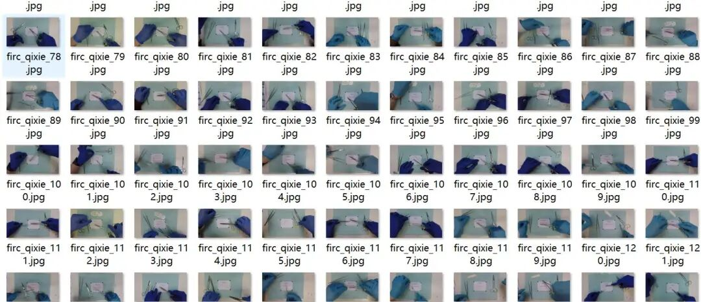
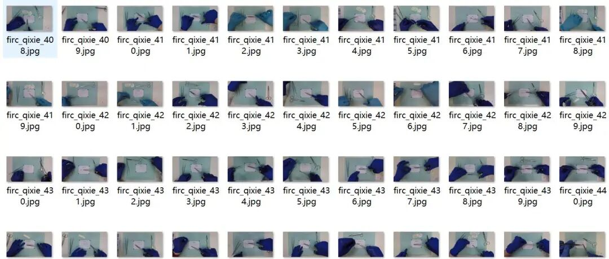
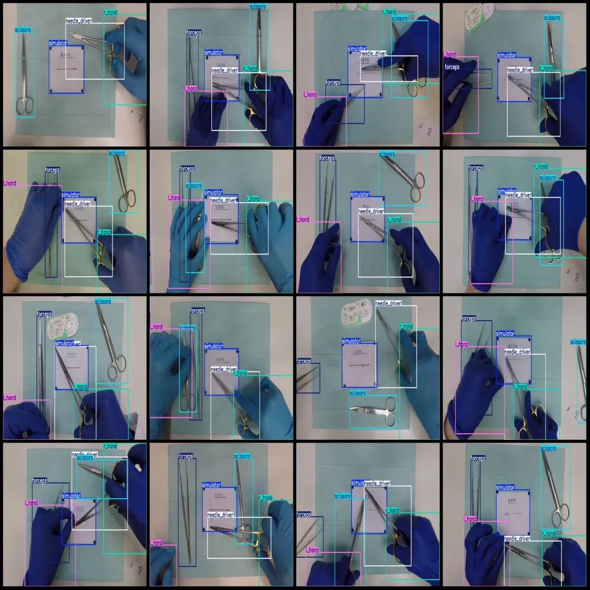

# Smart Medical Surgical Instruments Needle Driver Hand-Sided Forceps Simulator Test Data Set VOC+YOLO format with 505 images in 6 categories

Dataset format: Pascal VOC format + YOLO format (txt file without split path, only containing jpg images and corresponding VOC format xml files and yolo format txt files)

Number of images (number of jpg files): 505

Number of annotations (number of xml files): 505

Number of annotations (number of txt files): 505

Label count: 6

Label category names (note that the order of yolo format categories does not correspond to this, but is based on the labels folder's classes.txt): ["forceps", "l_hand", "needle_driver", "r_hand", "scissors", "simulator"]

Number of boxes labeled in each category:

Forceps (surgical forceps) frame count = 482

l_hand (left hand) frame count = 469

Needle driver (needle holder) frame count = 481

r_hand (right hand) frame count = 482

Scissors (surgical scissors) frame count = 484

Simulator (simulator) Frame Count = 503

Total frame count: 2901

Image resolution: 1920x1080

Using labelImg:

Annotation rules: Draw a rectangle around the category.

Important Notice: No

Special : This dataset does not guarantee the accuracy of the trained models or weight files.

Image resolution:

Annotation example:

## Payment

Here is a pay link on Stripe ( https://buy.stripe.com/3cs8yP7sY87d0vu9AB ). Please contact me lonlonago@foxmail.com after funding $89, and I will send you a complete data files , thank you!

